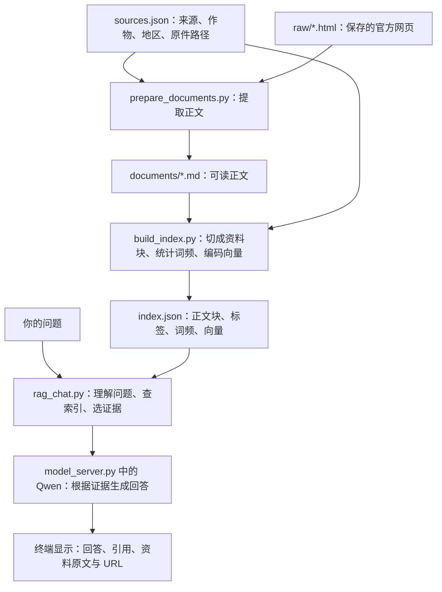

# 粮食作物 RAG：使用与学习手册

这是你用 Codex 边做边学的项目入口。项目目录是 **`/root/ai-workspace/rag_grains`**（末尾有 s）。

这个程序从本地官方农业资料中找证据，再让大模型组织带引用的回答。目前覆盖小麦、玉米、水稻；没有网页前端、图片识别、猫咪 LoRA 或 AutoGen 编排。日常使用在 Ubuntu 终端里完成。

第一次读先看第 1 节，跟一个问题走完流程；实际运行看第 2 节；模型和提示词查第 3～4 节，文件和命令查第 5～9 节。一次看完一个小节即可，不需要先记住所有文件名。

## 1. 跟着一个问题，走完整个工作流

这一节先不要求你读懂 Python。我们始终追踪同一个问题：

> 东北水稻育秧低温如何防范？

你要看清四样东西：资料原来在哪、代码怎样挑出资料、模型实际收到什么、屏幕上的答案怎样回来。

### 1.1 先分清：准备知识库，以及拿知识库回答问题

资料需要先整理好，程序才能检索。这里有两条相连的流程：



**准备资料**时运行清洗与索引脚本，生成硬盘文件；**每次提问**时问答脚本读取已经生成的索引。日常提问不重新下载网页、不重跑资料清洗，也不重新训练 Qwen。

先想象我们还没有输入问题，沿着上半条流程看资料是怎样准备好的。

### 1.2 资料是怎样从网页变成“可搜索的知识库”的

项目里已经保存了一份官方资料《2024年东北水稻育插秧技术意见》。

它的原始网页保存在：

```text
raw/rice_northeast_transplant_2024.html
```

HTML 是网页文件，里面不仅有技术正文，还可能有菜单、样式等内容。程序不会把整张网页都当成答案资料。

`sources.json` 相当于这份原件的登记卡，实际记录中包含：

```json
{
  "id": "rice-northeast-transplant-2024",
  "title": "2024年东北水稻育插秧技术意见",
  "crop": "水稻",
  "region": "东北地区",
  "raw_file": "raw/rice_northeast_transplant_2024.html",
  "document_file": "documents/rice_northeast_transplant_2024.md"
}
```

这里只摘出部分字段；实际还有来源机构、发布日期、原始 URL、生育期等。路径字符串告诉程序去读哪个文件，作物和地区字段告诉程序这份资料适用于哪里。

运行 `prepare_documents.py` 时，它读取登记卡，打开对应 HTML，提取正文，再写入对应 Markdown 文件。提取出的正文包括：

> 采取集中高台旱育、大棚三膜覆盖、综合增温等措施早育秧，防御低温冷害。

至此，资料从“原始网页”变成了“带来源信息的可读正文”。接下来还需要让程序能找到其中某一部分。

运行 `build_index.py` 时，主要做三件事：

1. **切块**：`split_document()` 按章节、段落把文章切成若干部分。用户问育秧时，优先找到育秧段落，避免把整份技术意见都塞给模型。
2. **记录可搜索信息**：保存每块的原文、章节、作物、地区、阶段、URL，并统计词频，供 BM25 关键词检索使用。这些标签也叫 metadata（元数据），就是“描述这段资料的信息”。
3. **生成向量**：用 bge-m3 把每块文字编码成一串数字，保存在索引中，便于以后比较意思是否相近。向量可理解为机器比较文本的数字表示，不需要你逐个理解数字。

最后写成 `index.json`。它包含类似下面的资料块（只展示部分字段）：

```json
{
  "source": "rice-northeast-transplant-2024",
  "crop": "水稻",
  "region": "东北地区",
  "section": "正文 > （三）加强管理，培育壮秧",
  "text": "采取集中高台旱育、大棚三膜覆盖、综合增温等措施早育秧，防御低温冷害。……"
}
```

实际块还带词频和向量。`index.json` 不只是文件名清单，**它已经保存了供检索和回答使用的正文**。因此，改完 `documents/` 却不重建索引，日常问答仍可能读到旧正文。

对应文件的关系现在是：

```text
raw/：原件
sources.json：原件的身份与适用范围
documents/：提取出的正文
index.json：提前整理好的资料块和搜索数据
```

到这里，知识库准备完成。下面才开始处理你的问题。

### 1.3 输入命令后，究竟是谁开始工作

你在终端 B 执行：

```bash
python rag_chat.py '东北水稻育秧低温如何防范？'
```

`python` 启动 `rag_chat.py`，引号里的文字作为参数传进去。`main()` 读取参数，再调用本文件的 `answer()`，由它协调后面的步骤。

最关键的调用关系是：

```text
rag_chat.py 的 main()
  → answer()
      → understand()       理解问题：来自 query_understanding.py
      → retrieve()        筛选并排序资料：在 rag_chat.py 中
      → call_model()      请求模型生成回答：在 rag_chat.py 中
  → print_result()        打印结果
```

这里的“调用函数”，就是执行一段已经写好的代码。`rag_chat.py` 通过 `import` 使用另一个 Python 文件里的函数，不需要你手动按顺序运行所有文件。

### 1.4 第一步：把问题变成检索条件

`query_understanding.py` 的 `understand()` 接收原问题，结合词表和默认的 Qwen 查询理解，整理出类似结果：

```json
{
  "crop": "水稻",
  "region": "东北",
  "growth_stage": "育秧"
}
```

这是说明数据形状的简化示例。程序还记录问题现象、语言、缺失条件等；模型返回的数据会经过规则校验，而不是全部照收。

为什么要先整理？因为“东北水稻育秧”和“长江中下游水稻成熟”可能都谈温度，但可用措施不同。程序需要明确条件来限制搜索范围。

同一个模块还做 Query Rewrite（查询改写）：将问题换成更适合搜资料的表达，保留原问题，并最多加入两条改写。例如“东北稻子苗棚降温了咋整”可以尝试改成“东北水稻育秧低温防范”。这是说明意图的示例，不保证模型每次输出这个措辞。改写是多找几种问法，不能替用户编造答案或补猜地区。

这一阶段 Qwen 收到的是“提取条件”或“改写问法”的提示词，**还没收到最终检索证据，也还没生成农业建议**。选择 `--understanding rules` 时，改用本地词表和模板完成这一步，不请求 Qwen。

### 1.5 第二步：先排除不适用的资料，再比较谁更相关

`answer()` 读取 `index.json`，把问题条件交给 `retrieve()`。

先用 `filter_chunks()` 做范围过滤：去掉不属于目标作物、地区、阶段的块；随后对低温等已定义现象检查原文关键词，避免仅因都在说“温度”就把高温段落拿来回答低温问题。

本次对示例问题用“规则理解 + BM25”实际检查，看到：

```text
索引里全部资料块        93
限制为水稻              16
再限制为东北            10
再限制为育秧             7
再要求存在低温相关证据    4
再去掉重复的总览块         3
```

这是当前索引的实测数量，更新资料后会变化。默认 Qwen 理解若识别出不同条件，后续数量也可能不同。

留下的块还需要排序。默认 `hybrid`（混合检索）采用：

| 处理 | 输入与输出 | 为什么需要 |
| --- | --- | --- |
| BM25 | 问题中的词 + 资料词频 → 一份候选排名 | 找“低温”“育秧”等关键词明确的原文 |
| bge-m3 向量检索 | 将问题编码为向量，与索引中提前算好的段落向量比较 → 另一份排名 | 补充“太冷”和“低温”等不同表达的匹配 |
| RRF 融合 | 原问题与改写的各份排名 → 合并排名 | 综合多路结果，不直接混加不可比的原始分数 |
| reranker 重排 | 问题 + 融合排名中最多 12 个候选 → 精排结果 | 更仔细判断每一块是否直接回答问题 |

最后默认选前 3 块，即 `top_k=3`。如果本来只有 3 个候选，就只处理这 3 个。向量模型负责找相近文本，重排模型负责挑选顺序，此时都没有生成最后的答案。

若选择 `--retrieval bm25`，就只走关键词排名与融合；向量或重排加载失败时也可能降级，程序会在诊断信息中说明。

### 1.6 第三步：把选中的原文变成模型实际收到的消息

检索结束后，程序得到一组含原文、范围、标题和来源的资料块。`evidence_text()` 给它们按本次排名编号：

```text
[资料 1] 标题：2024年东北水稻育插秧技术意见
章节：正文 > （三）加强管理，培育壮秧
适用范围：东北地区；育秧、整地、插秧和返青初期
原文：采取集中高台旱育、大棚三膜覆盖、综合增温等措施早育秧，防御低温冷害。……
```

`[资料 1]` 表示“这次选中的第一段”，不是资料库里永远固定的文件编号。换一个问题，第一段可能来自别的文件。

`call_model()` 写回答要求，`_request_answer()` 将要求、问题和证据拼成 HTTP 请求。下面是省略次要字段后的结构示意，展示的内容没有在本次文档修改中请求生成模型：

```json
{
  "model": "Qwen2.5-3B-Instruct",
  "messages": [
    {
      "role": "system",
      "content": "只依据检索证据回答，保留适用范围，每条结论附 [资料 N]。"
    },
    {
      "role": "user",
      "content": "问题：东北水稻育秧低温如何防范？\n检索证据：[资料 1] ……原文……"
    }
  ]
}
```

`system` 是程序写的行为要求；`user` 是本次问题和选出的原文。**这一步才把外部知识接到最终问答里：把原文作为消息内容发给模型。** Qwen 不会自行打开 `raw/` 或 `index.json`，也不会知道没有发给它的其他资料块。

### 1.7 第四步：本机 HTTP 服务让 Qwen 生成文字

为什么要两个终端？因为两个 Python 程序各自有工作：

| 运行位置 | 程序持续做什么 |
| --- | --- |
| 终端 A：`model_server.py` | 启动时加载 Qwen 模型，保持运行，等待别人提交请求 |
| 终端 B：`rag_chat.py` | 接收你的问题、查索引、把消息发给 A，再显示结果 |

终端 B 中 `_request_answer()` 向 `http://127.0.0.1:8002/v1/chat/completions` 发 POST 请求。`127.0.0.1` 是这台机器，`8002` 是终端 A 监听的端口，所以这次 HTTP 调用没有把问题交给云端模型。

终端 A 的 `chat()` 收到消息后，依次完成：

```text
消息列表
  → tokenizer.apply_chat_template()：按 Qwen 的对话格式排列文字
  → tokenizer(...)：把文字编码为 token 编号，供模型计算
  → model.generate()：根据输入预测后续 token
  → tokenizer.decode()：把新生成的编号还原为文字
  → 用 JSON 返回给终端 B
```

Token 是模型处理文本的单位，不一定等于一个汉字。Tokenizer 是做这种文字与编号转换的工具。

Qwen 在这个服务里加载一次，多次请求复用。终端 B 中的 BGE 模型则由检索程序按需加载；反复单次执行问答命令可能反复加载它们，因此首次运行或混合检索可能较慢。

### 1.8 第五步：检查引用、显示结果、记录过程

终端 B 从 JSON 中取出回答，检查它是否满足逐条引用的格式。首次不合格会请求模型再试一次；两次都不合格时，不展示那份生成答案，而是提示你先核对证据。

正常输出希望呈现为下面这样（仅为根据所示原文写的格式示例，不是本次生成模型实测）：

```text
- 可采用大棚三膜覆盖、综合增温等措施防御低温冷害。[资料 1]
```

`print_result()` 把识别范围、选出的原文、URL 和回答打印到终端。你可以根据 `[资料 1]` 回看那段证据，再通过 URL 回到官方来源。

默认还会向 `logs/retrieval_events.jsonl` 追加问题、范围、查询改写、排名、来源、耗时等检索记录；这份日志目前不保存完整生成答案。要复盘回答错误，请同时保存终端回答，或使用逐题报告脚本。

引用检查主要检查格式，不能保证模型没有读错、概括错。资料没有覆盖问题时，程序也可能在生成之前就停止：

| 停在哪 | 常见结果 |
| --- | --- |
| 没有索引 | `error`，提示先建立索引 |
| 严格模式缺条件 | `need_info`，提示补充范围 |
| 过滤后没有证据 | `out_of_scope`，说明现有资料不支持 |
| 证据有了但 Qwen 服务不可用 | 仍能显示证据，但不能生成答案 |
| 引用格式两次失败 | 显示拒绝展示的说明，保留证据供核对 |

### 1.9 以后修改项目时，从工作流中定位

如果你想“让模型使用另一份资料”，应该更新原件、登记册和索引；如果你想“让它回答更简短”，应该看最终生成提示词。它们修改的是不同环节：

| 你的目标 | 主要看哪里 | 怎么确认生效 |
| --- | --- | --- |
| 加一份官方资料 | `raw/`、`sources.json`、清洗脚本，再重建索引 | 新问题能检索到新资料的原文与 URL |
| 识别“稻子”“苗棚”等口语 | `domain_vocab.json`、`query_understanding.py` | 看识别范围和改写；若词表影响索引标签，也需重建索引 |
| 修复检索漏掉或排错 | `rag_chat.py` 的过滤、检索、排序；必要时看分块 | 用 `rag_check.py` 检查证据，再运行对应测试 |
| 改回答格式或长短 | `rag_chat.py` 的 `call_model()` 提示词及引用检查 | 真实提问，检查内容和引用 |
| 改生成模型或服务端口 | `model_server.py`，以及两个调用文件中的 `API_URL` | 健康检查，再测查询理解与完整问答 |

Codex 帮你修改这些脚本和文档；日常程序按上述代码执行。更新 `AGENTS.md` 会影响后续 Codex 怎样协作，**不会直接改变 Qwen 在 RAG 中收到的提示词**。

### 1.10 先亲眼看一遍“找资料”，再接模型

先执行下面这条轻量命令，不用启动模型服务：

```bash
cd /root/ai-workspace/rag_grains
source /root/ai-workspace/llm-dev-env/bin/activate
python rag_check.py '东北水稻育秧低温如何防范？' --understanding rules --retrieval bm25 --no-log
```

按顺序检查屏幕上的三处：

1. `识别范围`：是否是水稻、东北、育秧？这是问题变成检索条件的结果。
2. `检索过程`：是否能看见 `93 → 16 → 10 → 7` 对应的字段？这是资料被筛选的过程。
3. `[资料 1]`：能否看到官方标题、URL 和“防御低温冷害”的原文？这是已经找到的证据，此时没有最终生成答案。

这条命令用规则替代 Qwen 理解，用 BM25 替代混合检索，便于先观察关键过程。它完成“接收问题 → 识别条件 → 查索引 → 展示证据”。理解后按第 2 节启动服务、运行默认问答，再观察增加了 Qwen 理解、混合排序和最终生成的完整过程。

下面的命令和文件表，都是为了运行或调整这条流程。

## 2. 运行这条流程：两个终端

首次使用先确认 `index.json` 存在；不存在时看第 7 节。已有索引时，日常提问不必重新清洗资料或建索引。

**终端 A：启动 Qwen 模型服务。**

```bash
cd /root/ai-workspace/rag_grains
source /root/ai-workspace/llm-dev-env/bin/activate
python model_server.py --host 127.0.0.1 --port 8002
```

看到 `Uvicorn running on http://127.0.0.1:8002`，表示服务开始监听。保留终端 A；不要重复启动第二个 8002。启动前可用 `nvidia-smi` 看显存，避免与其他模型服务或训练争用资源。

**终端 B：检查服务，然后提问。**

```bash
cd /root/ai-workspace/rag_grains
source /root/ai-workspace/llm-dev-env/bin/activate
curl http://127.0.0.1:8002/health
python rag_chat.py '东北水稻育秧低温如何防范？'
```

健康检查应包含 `"status":"ok"`、`"model_loaded":true`、`"adapter_loaded":false`。问答会显示范围、证据和来源；成功生成的结论应带 `[资料 N]`。

连续聊天：

```bash
python rag_chat.py
```

输入 `quit` 退出。这只是循环接受问题，当前程序不会保存前几轮作为模型上下文；每个问题应说清自己的条件。交互模式建议把范围写在问题中。

用完后：终端 B 退出聊天，终端 A 按 `Ctrl+C` 停服务，释放模型占用的显存。

## 3. 到底用了哪些模型、环境与工具

### 三个模型，各管一件事

| 模型 | 用途 | 本机位置 |
| --- | --- | --- |
| `Qwen2.5-3B-Instruct` | 理解问题、改写检索表达、生成答案；需要英文时还做翻译 | `/root/ai-workspace/models/Qwen2.5-3B-Instruct/` |
| `BAAI/bge-m3` | Embedding（向量编码）：把问题和段落变成可比较的数字，寻找意思相近的文本 | `models/bge-m3/` |
| `BAAI/bge-reranker-v2-m3` | Reranker（重排）：更仔细比较问题与候选段落，重新排序 | `models/bge-reranker-v2-m3/` |

Qwen 通过 8002 HTTP 服务调用；两个 BGE 模型由检索 Python 程序直接加载。这里使用原始 Qwen 基座，**不加载之前的猫咪 LoRA**。模型下载好后可在本地运行，不依赖付费云端模型 API。

BM25 是关键词打分算法，RRF 是合并多个排名的算法，它们不是额外的大模型。索引直接存在 `index.json`，当前没有 Chroma、FAISS 或 Milvus 向量数据库。

### 环境和依赖

主环境是 `/root/ai-workspace/llm-dev-env`；不要混用旧的 `ai-env`，也不要在系统 Python 里安装项目包。

下表是整理文档时读取到的已安装版本，供排查参考；项目目前没有单独的依赖锁文件，不能仅凭此表保证换机器完全复现。

| 依赖 | 版本 | 做什么 |
| --- | --- | --- |
| Python | 3.12.14 | 运行脚本 |
| PyTorch（`torch`） | 2.11.0+cu128 | 模型计算与 GPU 推理 |
| `transformers` | 5.8.0 | 加载 Qwen 和 tokenizer（文本转模型输入） |
| `accelerate` | 1.11.0 | 支持模型设备分配，如 `device_map="auto"` |
| `FlagEmbedding` | 1.4.2 | 加载两个 BGE 模型 |
| `numpy` | 2.5.2 | 向量与相似度计算 |
| `fastapi` / `uvicorn` | 0.141.1 / 0.53.0 | 定义与运行 HTTP 服务 |
| `pydantic` | 2.12.3 | 检查 HTTP 请求的数据结构 |

日常无需重新安装。需要补依赖时，让 Codex 先解释原因并使用主环境；安装命令格式为：

```text
/root/.local/bin/uv pip install --python /root/ai-workspace/llm-dev-env/bin/python 包名
```

`包名` 是占位符，需替换。这里的 `uv` 是环境/包管理工具，路径是 `/root/.local/bin/uv`；主环境可能没有 `pip` 命令，不能因此判断环境坏了。

其他常用工具：Codex 读改代码和解释，Ubuntu Bash 运行命令，`curl` 检查 HTTP 接口，`nvidia-smi` 查看 GPU，`rg` 搜代码。当前项目目录不是 Git 仓库，不能假设有 Git 历史可回滚。

## 4. 模型是怎么被调用的，提示词在哪里

服务地址：`http://127.0.0.1:8002`。`127.0.0.1` 表示本机，`8002` 是服务端口；`GET /health` 用来检查状态，`POST /v1/chat/completions` 用来提交聊天请求。

普通 RAG 命令会自动调用模型，你不用自己写 HTTP。想单独验证 Qwen 服务，可在终端 B 执行：

```bash
curl http://127.0.0.1:8002/v1/chat/completions \
  -H 'Content-Type: application/json' \
  -d '{"model":"Qwen2.5-3B-Instruct","messages":[{"role":"user","content":"用一句话介绍自己"}],"temperature":0,"max_tokens":80}'
```

这只测试 Qwen，会返回 JSON；没有运行 RAG 检索。只请求聊天接口不会自动读取农业资料。接口兼容常见 OpenAI 聊天请求格式，实际计算仍在本机。

| 想找什么 | 文件与函数 |
| --- | --- |
| 模型路径、加载、生成参数、HTTP 接口 | `model_server.py`：`MODEL_PATH`、`load_model()`、`chat()` |
| 理解问题的提示词 | `query_understanding.py`：`_call_llm()` 的 `system` |
| 查询改写的提示词 | `query_understanding.py`：`_rewrite_with_llm()` 的 `system` |
| 最终回答的提示词 | `rag_chat.py`：`call_model()` 的 `system` |
| 拼证据、发 HTTP 请求 | `rag_chat.py`：`evidence_text()`、`_request_answer()` |
| 英文翻译的提示词 | `rag_chat.py`：`_translate_cited_answer()` |
| 调整口语别名、规范地区和阶段 | `domain_vocab.json` |

程序把行为要求放进 `system` 消息，把“问题 + 检索证据”放进 `user` 消息。一次提问可能调用 Qwen 多次：理解、改写、生成，必要时重试或翻译。因此不只是简单的一次聊天。

## 5. 文件地图：遇到什么需求看哪里

以下路径都相对本项目目录；`.py` 是 Python 脚本，`.json` 保存结构化数据，`.jsonl` 每行是一条 JSON 记录，`.md` 是你正在看的 Markdown 文档。

| 文件或目录 | 用途 / 何时关注 |
| --- | --- |
| `README.md` | 运行与学习入口，即本文件 |
| `AGENTS.md` | 给 Codex 的协作与操作规范，你也可以检查和修改 |
| `ARCHITECTURE.md` | 技术实现、设计取舍和历史实验说明 |
| `PROJECT_EXPLAINER.md` | 面向初学者和导师沟通的详细项目介绍 |
| `sources.json` | 每份资料的标题、机构、日期、URL、作物、地区、生育期及文件路径 |
| `domain_vocab.json` | 作物、地区、阶段、口语别名、风险词等词表 |
| `raw/*.html` | 原始官方网页快照，保留原件，不直接改写 |
| `documents/*.md` | 从快照生成的正文，文件头保留来源信息 |
| `prepare_documents.py` | 依据登记册清洗支持的 HTML，生成/覆盖正文；不自动下载网页 |
| `build_index.py` | 读取正文和登记册，分块并建立 BM25/向量索引 |
| `index.json` | 生成的检索索引；可重建，不手工编辑 |
| `query_understanding.py` | 识别条件、检查字段、查询改写；模型不可用时回退规则 |
| `rag_chat.py` | 主程序：串起理解、过滤、检索、重排、生成和日志 |
| `rag_check.py` | 精简检索检查工具，显示范围、分数、来源和原文预览 |
| `model_server.py` | 在 8002 启动 Qwen 服务，供上述程序调用 |
| `models/bge-m3/`、`models/bge-reranker-v2-m3/` | 两个检索模型的本地权重，不是训练输出 |
| `tests/questions.jsonl` | 统一的 36 条测试问题、预期范围/来源/状态，每种作物 12 条 |
| `tests/evaluate_retrieval.py` | 批量检索检查，比较预期来源是否进入前 3 条证据 |
| `tests/evaluate_query_understanding.py` | 检查条件识别、缺失条件处理和查询改写 |
| `tests/evaluate_end_to_end.py` | 调用 Qwen，检查完整链路的状态、来源、引用和语言 |
| `tests/run_question_review.py` | 逐题运行并生成适合人工阅读的 Markdown 报告 |
| `logs/retrieval_events.jsonl` | 每次人工查询追加的日志；用 `--no-log` 可关闭 |
| `logs/retrieval_report*.json` | 批量检索结果；`*_current.json` 是测试脚本常用输出 |
| `logs/end_to_end_report.json` | 完整链路自动检查结果 |
| `logs/question_set_review.md` | 当前整套题的逐题答案、证据与核对报告 |
| `logs/manual_review_report.md` | 较早的人工核对报告，属于历史记录 |
| `logs/model_download.log`、`logs/reranker_*` | 模型下载时留下的日志和排查记录，日常无需操作 |
| `__pycache__/` | Python 自动生成的缓存，不是你要维护的源码 |

当前有 12 份资料，索引有 93 个块（数量会随资料更新）。`documents/` 中每个文件与 `raw/` 里的同名 HTML 对应：

| 作物 | 正文文件名与主题 |
| --- | --- |
| 小麦 | `wheat_autumn_2026.md` 秋冬种；`wheat_spring_2017.md` 春季田管；`wheat_cold_2022.md` 倒春寒；`wheat_pest_2022.md` 秋冬季病虫害 |
| 玉米 | `maize_spring_2024.md` 春播；`maize_summer_2023.md` 黄淮海夏玉米；`maize_one_spray_2025.md` 一喷多促；`maize_pest_2024.md` 重大病虫害 |
| 水稻 | `rice_northeast_2020.md` 东北生产；`rice_northeast_transplant_2024.md` 育插秧；`rice_yangtze_2012.md` 长江中下游田管；`rice_south_flood_2024.md` 南方防涝 |

它们是有日期与适用范围的技术意见，不是全国全年通用手册。不要跨作物、地区、阶段套用措施；涉及农药，应回看原文、当地登记、产品标签和植保意见。

## 6. 常用玩法与参数

每个新终端先进入项目、激活环境。以下命令都在项目目录执行。

**先看证据，不运行 Qwen，也不加载两个 BGE 模型：**

```bash
python rag_check.py '东北水稻育秧低温如何防范？' --understanding rules --retrieval bm25 --no-log
```

**看混合检索证据，不调用 Qwen，但会加载向量/重排模型：**

```bash
python rag_check.py '东北水稻育秧低温如何防范？' --understanding rules --retrieval hybrid
```

**常规问答，需要已启动 Qwen 服务：**

```bash
python rag_chat.py '东北稻子苗棚降温了咋整？'
python rag_chat.py '苗棚降温了咋整？' --crop 水稻 --region 东北 --stage 育秧
python rag_chat.py '东北水稻育秧低温如何防范？请用英语回答'
```

| 参数 | 意思 |
| --- | --- |
| `--retrieval bm25` | 关键词检索，轻量、易排查 |
| `--retrieval vector` | 语义向量检索，需 bge-m3 和向量索引 |
| `--retrieval hybrid` | 默认：BM25 + 向量 + RRF + 重排 |
| `--understanding llm` | 默认：Qwen 理解与改写；失败时尝试退回规则/模板 |
| `--understanding rules` | 用词表与模板理解、改写，不调用 Qwen 做这两步 |
| `--retrieve-only` | `rag_chat.py` 不生成最终回答；默认理解步骤仍可能调用 Qwen |
| `--scope-policy adaptive` | 默认：按已知条件检索，同时提示缺失范围 |
| `--scope-policy strict` | 条件不足或有歧义时停止，要求补充信息 |
| `--crop` / `--region` / `--stage` | 手动指定作物/地区/生育期，单次提问时使用 |
| `--top-k 3` | 返回几段证据，默认 3，可选 1～5 |
| `--no-log` | 不追加人工查询日志 |
| `--help` | 查看该脚本支持的参数 |

注意：`rag_check.py` 本身不生成最终答案，但默认也使用 `llm` 查询理解。要完全不调用 Qwen，必须选 `--understanding rules`；要完全不加载任何模型，再选 `--retrieval bm25`。旧 `rag_test` 的 `--show-context` 不适用于这里，这里的程序已直接展示证据。

向量或重排失败时程序可能降级；看 `used_mode` 和 warning 才知道实际用了什么，不能只看自己传入了 `hybrid`。

## 7. 更新资料、索引与测试

这组命令会覆盖生成文件，只在添加资料、改变清洗或分块规则时运行：

```bash
python prepare_documents.py
python build_index.py
```

`prepare_documents.py` 覆盖登记的 `documents/*.md`；`build_index.py` 覆盖 `index.json`，默认有本地 bge-m3 时会重新算向量，可能占用显存。不要日常每次提问都执行。

新增资料的顺序：确认权威来源与适用范围 → 保留原始快照到 `raw/` → 登记 `sources.json` → 让 Codex 适配提取规则 → 核对生成正文 → 建索引 → 增加针对性测试。当前清洗器只支持特定 HTML 结构；PDF/Word 需要补提取流程，不能直接改扩展名入库。

索引仅想试 BM25 时，可让 Codex 用 `--skip-vectors --output index_bm25_experiment.json` 写到新文件，保护现有向量索引；主问答脚本默认只读 `index.json`，不会自动改读实验索引。

**测试按需跑，不必每次全跑。** 以下命令中 `PYTHONPATH=.` 表示让测试脚本能导入当前项目的代码，仅对这一条命令生效。

```bash
# 快速检索回归：不调用 Qwen，不加载 BGE 模型
PYTHONPATH=. python tests/evaluate_retrieval.py --retrieval bm25

# 混合检索回归：不调用 Qwen，但加载 BGE 模型
PYTHONPATH=. python tests/evaluate_retrieval.py --retrieval hybrid

# 用规则检查查询理解，不需要 Qwen 服务
PYTHONPATH=. python tests/evaluate_query_understanding.py --understanding rules

# 以下需要 Qwen 服务，耗时更长
PYTHONPATH=. python tests/evaluate_query_understanding.py --understanding llm
PYTHONPATH=. python tests/evaluate_end_to_end.py
PYTHONPATH=. python tests/run_question_review.py
```

测试会写入或覆盖 `logs/` 中相应报告；想保留旧结果时，先请 Codex保存副本。最适合你检查的是 `logs/question_set_review.md`：看每题是否找对资料、回答是否逐句被证据支持、引用是否正确。旧报告是历史结果，不代表当前版本刚刚测试过。

## 8. 基础命令速查

在 Ubuntu 终端粘贴命令时，不要复制提示符里的 `root@...#` 或 `(llm-dev-env)`。`#` 开头是注释；多行命令末尾的 `\` 表示续行，后面不要多加空格。

| 命令 | 用处 |
| --- | --- |
| `pwd` | 看当前在哪个目录 |
| `ls -lah` | 看当前目录的文件、隐藏文件和大小 |
| `cd /root/ai-workspace/rag_grains` | 进入项目；用绝对路径不怕当前目录不同 |
| `cd ..` | 返回上一级目录 |
| `source /root/ai-workspace/llm-dev-env/bin/activate` | 激活主环境 |
| `which python` / `python --version` | 确认解释器位置和版本 |
| `deactivate` | 退出虚拟环境，不会删除环境 |
| `python rag_chat.py --help` | 查看问答参数 |
| `less README.md` | 分页读文件，按 `q` 退出 |
| `rg -n 'API_URL' rag_chat.py query_understanding.py` | 搜接口地址并显示行号 |
| `find documents -maxdepth 1 -type f` | 列出知识正文文件 |
| `python -m json.tool sources.json >/dev/null` | 检查登记册 JSON 语法；成功通常无输出 |
| `tail -n 5 logs/retrieval_events.jsonl` | 看最近 5 条人工查询日志 |
| `nvidia-smi` | 看 GPU 显存与进程 |
| `ss -ltnp 'sport = :8002'` | 看谁在监听 8002 端口 |
| `du -sh models` / `df -h .` | 看模型目录大小 / 所在磁盘剩余空间 |
| `Ctrl+C` | 停止当前前台程序 |
| `clear` | 清屏，不删除文件、不停止模型 |

## 9. 报错时按这个顺序查

| 现象 | 先做什么 |
| --- | --- |
| `python: command not found` 或 `ModuleNotFoundError` | 激活主环境，检查 `which python`；不要立刻向系统装包 |
| 找不到脚本 | 用 `pwd`，再 `cd /root/ai-workspace/rag_grains` |
| `Connection refused` / 服务不可用 | `curl http://127.0.0.1:8002/health`；在终端 A 启动服务 |
| `Address already in use` | 用 `ss` 查 8002；已有正确服务就复用，不要盲目杀进程 |
| `CUDA out of memory` | 用 `nvidia-smi` 查占用；先用 BM25 + rules 排查，请 Codex 确认要停止哪个任务 |
| 提示索引不存在 | 确认正文和登记册存在，再运行 `python build_index.py` |
| `need_info` | 严格模式缺条件；补作物、地区、阶段，或使用默认 adaptive |
| `out_of_scope` | 当前资料/证据不覆盖问题，查看来源与范围，不代表程序坏了 |
| 检索正确但回答不对 | 保存问题、原文和回答，让 Codex 检查生成提示词与引用 |
| 模型两次引用格式不合格 | 程序拒绝展示生成内容，先读检索证据；不要直接删掉校验 |
| 混合检索变成 BM25 | 查看 warning，检查 BGE 模型路径、向量索引、依赖和显存 |

## 10. 用 Codex 边做边学

`AGENTS.md` 是后续 Codex 的项目操作说明；你主要读本 README，技术细节再看 `ARCHITECTURE.md` 和 `PROJECT_EXPLAINER.md`。

可以直接这样给 Codex 任务：

> 先读 rag_grains/AGENTS.md 和 README.md。我是初学者，请先说清涉及哪些文件，完成修改和验证后，用中文解释这次我应该学到的两个知识点。

> 这个问题回答不对：……。请先展示识别条件和证据，判断问题在理解、检索还是生成，再修复；保留已有资料和报告。

> 带我学 rag_chat.py，每次只讲一个函数，配“东北水稻育秧低温”的例子，等我理解再继续。

建议学习顺序：跑通一次提问 → 看 `sources.json` 和一份正文 → 用 `rag_check.py` 看检索 → 找提示词和 HTTP 调用 → 在 Codex 帮助下新增一份资料与测试。每次改一个能观察到效果的小目标，并保存“问题、证据、修改、验证结果”。

当前是小规模资料与测试项目。36 题结果不能证明所有农业问题都可靠；向量相似、引用格式通过，也不能替代逐句核对官方原文。
